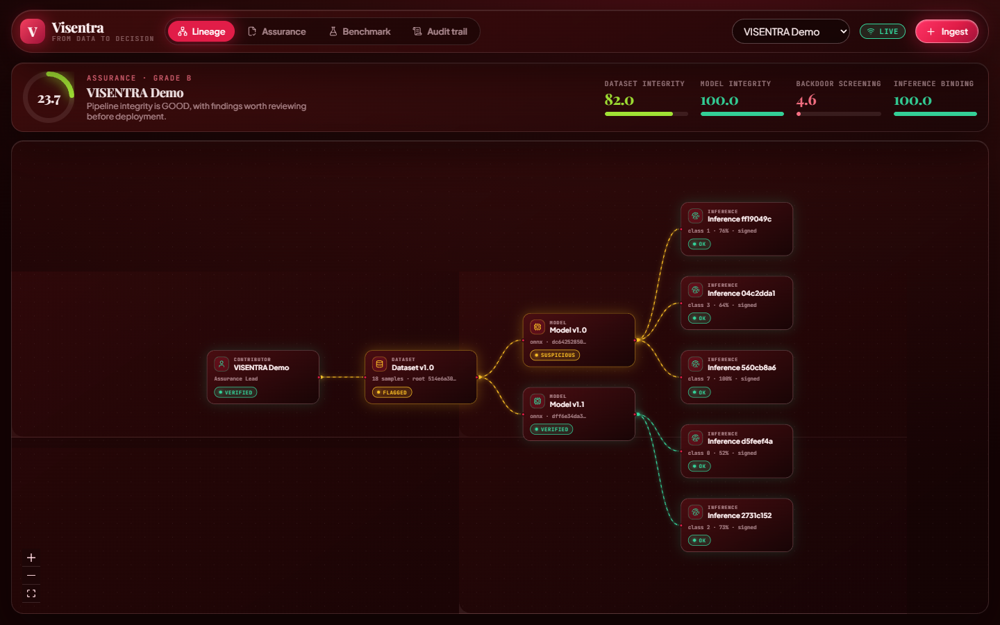

# VISENTRA

**From data to decision, proving AI integrity.** (Smart India Hackathon SIH26228)

VISENTRA is a forensic workstation for computer vision supply chains. It ties
cryptographic provenance (hashes, Merkle roots, Ed25519 signatures) to behavioural
checks (dataset screening and Trojan interrogation) on one live lineage graph, so a
poisoned sample, a flipped weight bit or a planted backdoor all show up in the same
place, and every prediction downstream of them loses its certificate.



## The four pillars

| Pillar | What it proves | How |
|---|---|---|
| **I · Dataset integrity** | the training data is what was registered, and is clean | archives unpacked into content-addressed samples sealed by a SHA-256 Merkle root; 64-bit DCT pHash near-duplicates (Hamming ≤ 8); 512-D embedding scored with 0.55·Isolation Forest + 0.45·leave-one-out Mahalanobis (Hotelling T² normalised) |
| **II · Model integrity** | the checkpoint has not changed since registration | SHA-256 plus a rename-invariant topology fingerprint, both computed in a network-less, resource-capped sandbox; byte-level diff naming the tensors a bit-flip touched |
| **III · Backdoor screening** | the model does not hide a trigger | two-stage gate: five triggers × five anchors + STRIP superimposition, escalating to penultimate-layer activation clustering only when the black-box score crosses τ = 0.18 |
| **IV · Inference binding** | each prediction came from exactly these artifacts | Ed25519 signature over (dataset root, model hash, topology, input hash, config hash, output, timestamp); tampering upstream invalidates certificates downstream in a staggered live cascade |

The four scores are combined with the blueprint's decoupled formula
`S = 0.20·S_data + 0.30·S_model + 0.25·S_backdoor + 0.25·S_infer`, and the report can
be exported as a signed certificate that anyone can verify offline.

## Quick start

```bash
# backend (Python 3.11+)
python -m venv .venv && . .venv/bin/activate          # .venv\Scripts\activate on Windows
pip install -r backend/requirements-dev.txt
uvicorn backend.main:app --reload --port 8000          # seeds a demo pipeline on first start

# frontend (Node 22)
cd frontend && npm ci && npm run dev                   # http://localhost:5173
```

Or with Docker: `docker compose -f infra/docker-compose.yml up --build` (UI on :5173, API on :8000, Postgres underneath).

The seeded demo contains a screened dataset with a planted near-duplicate and texture
outlier, a Trojaned model v1.0 and its clean twin v1.1, and five signed inferences.
Click **Model v1.0 → Bit-flip attack** and watch the cascade. [docs/USER_GUIDE.md](docs/USER_GUIDE.md) walks through the full five-minute demo.

## VisentraBench

`python scripts/run_visentrabench.py` builds 180 supply-chain pipelines across five
strata from scratch and scores four methods on them (results in
[docs/benchmark](docs/benchmark/README.md)):

| Method | Attack recall (95% CI) | Clean FPR | Mean latency |
|---|---|---|---|
| B1 hash only (SLSA / in-toto style) | 50.0% (41.9–58.1) | 0.0% | 0.9 ms |
| B3 STRIP only | 15.3% (10.3–22.0) | 0.0% | 252 ms |
| B4 activation clustering, no gate | 0.7% (0.1–3.8) | 5.6% | 255 ms |
| **VISENTRA complete** | **98.6% (95.1–99.6)** | 13.9% | 481 ms |

All of VISENTRA's false positives come from Pillar I on 16-image datasets, at the
blueprint's thresholds. The benchmark is a controlled study on procedural data, not a
substitute for CIFAR-10 or GTSRB, and the write-up says so.

## Repository map

```
backend/
  api/            FastAPI routers (lineage, datasets, models, scans, inference, report, audit, bench)
  assurance/      dataset checks, archive unpacking, backdoor engine, signer, model zoo, procedural data
  sandbox/        subprocess worker that is the only place models are ever loaded
  bench/          VisentraBench harness
  db/             SQLAlchemy models and Alembic migrations
frontend/         React 19 + Three.js "Cherry Cinema" workstation
scripts/          demo seeder, benchmark runner, CI smoke check
docs/             research blueprint, roadmap, benchmark results, user guide, screenshots
tests/            pytest suite (92% coverage, gate at 85%)
```

## Development

```bash
ruff check backend scripts tests && ruff format --check backend scripts tests
pytest -q --cov
alembic upgrade head && alembic check
cd frontend && npm run lint && npm run typecheck && npm run build
```

CI runs all of the above, an end-to-end smoke test against a live server, and both
Docker image builds on every pull request.

## Configuration

See [backend/.env.example](backend/.env.example). The important ones: `DATABASE_URL`,
`STORAGE_ROOT`, `SIGNING_KEY` (otherwise a key is generated under `storage/keys`),
`ENABLE_DEMO` and `AUTO_SEED` (turn both off outside demos) and `EMBEDDER_ONNX` to
plug in a real backbone for OOD embeddings.

## Limitations

The report lists them, and they are worth repeating. Trojan screening covers a fixed
trigger library and is not a proof of absence. Hashes and signatures cannot detect an
artifact that was malicious when it was first registered (that is what Pillars I and
III are for). The default OOD embedding is hand-built. And whoever holds the signing
key can mint certificates.
